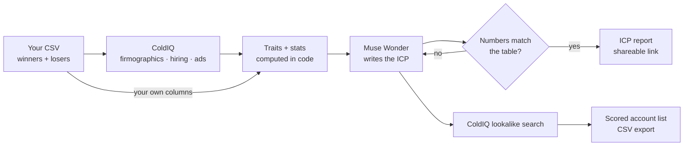

# ICP Detective

**Find out who your best customers really are. Upload your winners and losers, let ColdIQ fill in the data, and get an ideal customer profile where every number is computed in code and explained by Muse Wonder.**

ICP Detective runs on your own computer with your own keys. You upload a CSV of your best customers and, ideally, the ones that churned or the deals you lost. [ColdIQ](https://coldiq.com)'s Unified API looks up each company: industry, headcount, revenue, funding, tech stack, hiring and advertising. The app then counts which traits separate winners from losers, and Meta's **Muse Wonder** model reads that table and writes your ICP: the must-have traits, the anti-ICP, the surprises and the caveats. Finally, ColdIQ finds lookalike companies and each one is scored against your ICP.

It doesn't send anything to anyone. It answers one question: *who should we actually be selling to?*

It also includes **[Offer Check](#offer-check)**, for the other side of the table: got a job offer? Enter the company's website and get a health check in about a minute (funding, hiring trend, team growth and news, scored by fixed rules), with questions to ask in your interview.

---

## Contents
1. [Why it exists](#why-it-exists)
2. [How it works](#how-it-works)
3. [Features](#features)
4. [Offer Check](#offer-check)
5. [Quick start (5 minutes)](#quick-start)
6. [Connecting each tool](#connecting-each-tool)
7. [Preparing your CSV](#preparing-your-csv)
8. [Running a study](#running-a-study)
9. [How the numbers are computed](#how-the-numbers-are-computed)
10. [Credits and costs](#credits-and-costs)
11. [Privacy and safety](#privacy-and-safety)
12. [Troubleshooting](#troubleshooting)
13. [Configuration reference](#configuration-reference)
14. [Project structure and development](#project-structure-and-development)
15. [Roadmap](#roadmap)

---

## Why it exists

Every outbound tool asks you for your ICP on day one. Most teams type in a guess. These are the problems ICP Detective was built to solve:

### 1. The ICP is written from memory
Most ICPs come from a workshop, a founder's gut or the logos everyone remembers. They describe who the team *thinks* buys, not who actually stays and pays. Every list, sequence and ad budget downstream inherits that guess.

**What ICP Detective does:** it starts from your real customer list. The ICP is whatever the data says your winners have in common, with the counts to prove it.

### 2. Looking only at winners is misleading
If 80% of your best customers use Google Workspace, that tells you nothing when 80% of your churned customers do too. Most "analyse my customers" exercises look at winners alone and mistake what is common for what is predictive.

**What ICP Detective does:** it compares winners against losers (churned customers or lost deals) and ranks traits by how much more common they are among winners. With no comparison group it still works, but it says clearly that the evidence is weaker.

### 3. The data is spread across a dozen tools
Firmographics live in one database, tech stack in another, hiring data in a third and ad data in a fourth. Pulling it together for a few hundred accounts is a week of exports and VLOOKUPs, so nobody does it.

**What ICP Detective does:** one ColdIQ key reaches 40+ data providers. Pick the lenses you want (firmographics, hiring, advertising) and every company is enriched in one run. Your own CSV columns (plan, source, use case, region) are analysed alongside, at no cost.

### 4. AI that invents statistics
Ask a chatbot to "find patterns in my customers" and it will happily tell you that 87% of them are Series B fintechs, whether or not that's true. A confident wrong ICP is worse than no ICP.

**What ICP Detective does:** every count is computed in plain code. Muse Wonder only sees the finished table and is told to cite traits by id and quote counts exactly. Then the code checks every fraction and percentage in the model's answer against the table. Anything that doesn't match is sent back for one retry and, if it still doesn't match, it is shown with a "not verified" warning.

### 5. Lookalikes that only look alike on paper
"Companies like our best customers" usually means "same industry and size". That finds companies that look similar but miss the trait that actually mattered.

**What ICP Detective does:** ColdIQ's lookalike search starts from your best winners (highest deal value first) and is narrowed by the ICP. Each result is then scored in code against the must-have and anti-ICP traits, with a plain list of what matched, what was missing and what couldn't be checked.

### 6. Paying for data you never use
Enrichment is usually bought in bulk, in advance, and most of it is never looked at.

**What ICP Detective does:** ColdIQ charges only when data is found. On top of that, a credit governor caps spending per run, per day and per company, and sends the remaining allowance with every call as `max_credits`, so a call can never cost more than what is left. The 300 free credits are enough for a first real study.

### At a glance

| Problem | What ICP Detective does |
|---|---|
| ICP written from memory | Derived from your real customer list |
| Winners-only analysis | Winners vs churned or lost, ranked by lift |
| Data spread across tools | One ColdIQ key, 40+ providers, plus your own CSV columns |
| AI that invents numbers | Counts computed in code, every cited number checked |
| Shallow lookalikes | Lookalikes of your best winners, scored against the ICP |
| Wasted data spend | Charge on success, hard credit caps, `max_credits` on every call |

---

## How it works



1. **Upload.** A CSV with a domain per company and a label (winner or loser). Extra columns become traits too.
2. **Enrich.** For each company, each selected lens is one ColdIQ call. Results are normalised into a profile.
3. **Count.** Profiles become traits ("Uses Shopify", "51-200 employees", "Hiring in Sales", "Plan: Pro"). For each trait the app counts winners and losers that have it, *out of those whose data is known*, and computes a smoothed lift.
4. **Explain.** Muse Wonder reads the top traits and writes the headline, the ICP summary, must-have and nice-to-have traits, the anti-ICP, surprises, caveats and search filters.
5. **Verify.** Code checks the trait ids and every number in the answer.
6. **Find lookalikes.** ColdIQ searches for companies similar to your best winners, narrowed by the ICP's filters. Each is scored in code.
7. **Share.** A public report link (aggregates only, no customer names) and a self-contained HTML download.

---

## Features

- **CSV import** that handles commas, semicolons or tabs, common column names (website, ARR, outcome, churned…) and up to 10 custom columns.
- **Three ColdIQ lenses:**
  - **Firmographics:** industry, headcount, revenue, country, founding year, funding stage and tech stack.
  - **Hiring:** open roles in the last 90 days, grouped by department.
  - **Advertising:** whether the company runs ads, and on which platforms.
- **CSV-only mode:** analyse your own columns with no ColdIQ key and no credits.
- **Winner-vs-loser stats** with lift, support thresholds and data coverage per trait group. Missing data never counts as "doesn't have it".
- **Deal value awareness:** when you include deal value, the trait table shows average deal value with and without each trait, and the best-paying winners seed the lookalike search.
- **Grounded AI analysis:** trait ids and numbers are checked in code, with one automatic retry and visible warnings.
- **Lookalike accounts** scored 0-100 against the ICP, with the reasons, exported as CSV.
- **Shareable report** at an unguessable link, plus a downloadable HTML file. No customer names or domains in it.
- **Credit governor:** caps per run, per day and per company, plus a live balance and the $ value from ColdIQ.
- **Resumable enrichment:** a study paused by a cap continues where it stopped.
- **Events page** showing every ColdIQ call, the credits it cost and the raw response.
- **Keys entered in the app** (or in `.env.local`), stored only on your machine.

---

## Offer Check

### The problem

People accept job offers at startups that freeze hiring or run out of money a few months later. The warning signs are usually public: no funding for years, open roles disappearing, the team shrinking, layoffs or leaders leaving in the news. But checking them means digging through funding databases, careers pages and news by hand, and Glassdoor shows opinions, not data. Founder runway calculators don't help either: they need the company's cash and burn, which a candidate never sees.

### What it does

Enter a company website and, optionally, the role you were offered. Offer Check makes four ColdIQ calls, computes the facts in code and scores four areas:

| Area | Data (ColdIQ) | Green | Amber | Red |
|---|---|---|---|---|
| Funding (30%) | Funding events | Last round 18 months ago or less | 19-30 months | Over 30 months (amber at most for companies with 1,000+ people, which often fund themselves) |
| Hiring (30%) | Job openings with first and last seen dates | Open roles now are at least 80% of 90 days ago | 40-80% | Under 40%, or the careers page was checked and is empty |
| Team (20%) | Company enrichment | Headcount growth 0% or more over 12 months | 0% to -10% | Under -10% |
| News (20%) | News events, last 12 months | No warning signs | Incidents, a merger, asset sales or one senior leader leaving | Layoffs, office closures, or two or more senior leaders leaving |

- **Unknown is not bad.** An area with no data is shown as "Unknown" and left out of the score. If less than half of the weight is known, there is no score, just "Not enough data".
- **The score** is the weighted average of the known areas (green 100, amber 50, red 0).
- **If you give your role**, it also counts the open roles in that department (for example "open Sales roles now: 6").
- **Muse Wonder** then writes a short verdict, what looks good, what to watch and five questions to ask in your interview. It gets only the numbered fact table, and every number it writes is checked against that table (one retry, then a "not verified" label).
- **Share it:** each check has a public link (`/o/<token>`, not indexed) and a 1200x630 image card for X and LinkedIn previews.

### Why there's no runway estimate

An early version estimated runway from the last round and the headcount. Tested on real companies, it called healthy, fast-growing companies "red" because public data has no revenue figures. A guess like that does more harm than good, so the runway question is now one of the interview questions instead.

### Real example (October 2026)

| Company | Funding | Hiring | Team | News | Score |
|---|---|---|---|---|---|
| linear.app | Series C, 16 months ago | 43 open roles vs 36 | +10% | No warning signs | 100 |
| vercel.com | Series F, 12 months ago | 126 open roles vs 78 | +4% | 27 security incidents reported, a Chief Revenue Officer left | 90 |

### Cost and limits

- About **11 credits per company** (company enrichment about 3.5, then three flat 2.51-credit calls), roughly $0.16. A check never spends more than the cap in Settings (default 15).
- Checking the same company again within **7 days is free**: the saved data is reused.
- People are described **by role only** ("A Chief Revenue Officer left"), never by name. Raw provider data stays on your computer.
- Public data can be late or incomplete, and some companies aren't covered. **Not financial or career advice.**

---

## Quick start

You need **Node.js 22.13 or newer** (`node -v`).

```bash
git clone https://github.com/thoughtpilot99/muse-x-coldiq.git
cd muse-x-coldiq
npm install
npm run dev
```

Open http://localhost:3000 and follow the checklist on the home page:

1. **Setup:** paste your Muse Wonder key and your ColdIQ key, then press *Test*. The ColdIQ test is free and shows your balance.
2. **Settings:** describe what you sell in one or two sentences.
3. **New study:** upload your CSV, pick lenses, create.
4. Press **Enrich with ColdIQ**, then **Find my ICP**, then **Find lookalikes**.

For an always-on install use `npm run build && npm start`.

---

## Connecting each tool

### 1. Muse Wonder (required for the analysis)
1. Go to [dev.meta.ai](https://dev.meta.ai) and create an API key.
2. Paste it on **Setup → Muse Wonder**, then press *Test Muse Wonder*.

The model is `muse-wonder-1.0` by default (change it with `MUSE_MODEL`). One analysis is one or two model calls.

### 2. ColdIQ (the data; optional for CSV-only studies)
1. Sign up at [login.coldiq.com/sign-up](https://login.coldiq.com/sign-up). New accounts get **300 free credits**, no card needed.
2. Create an API key in the ColdIQ dashboard.
3. Paste it on **Setup → ColdIQ**, then press *Test ColdIQ (free)*. You should see your balance and the dollar value of a credit.

The app uses these ColdIQ endpoints:

| Endpoint | Used for | Billing |
|---|---|---|
| `GET /v1/me/credits` | Balance on the home page and the Setup test | Free |
| `POST /v1/company/enrich` | Firmographics lens | Charged on success |
| `POST /v1/jobs/search` | Hiring lens | Charged on success |
| `POST /v1/ads/search` | Advertising lens | Charged on success |
| `POST /v1/companies/search` | Lookalike accounts | Charged on success |

Every paid call is sent with `max_credits` set to the smallest remaining cap and with `soft_miss: true`, so a company with no data is recorded as "nothing found" rather than as an error.

---

## Preparing your CSV

| Column | Required | Accepted names | Notes |
|---|---|---|---|
| Domain | yes | domain, website, url, company domain | `https://www.acme.com/about` becomes `acme.com` |
| Name | no | company, name, account | Shown in the app only, never in the report |
| Label | no | label, outcome, status, type, segment | winner: won, customer, active, yes. loser: lost, churned, cancelled, no. Empty means winner |
| Deal value | no | deal value, ARR, MRR, ACV, amount, LTV | Currency symbols and separators are ignored |
| Anything else | no | any | Up to 10 extra columns become traits (e.g. plan, lead source, use case) |

A template is linked on the New study page (`public/icp-detective-template.csv`).

**How many companies?** At least 3 winners to run an analysis. A useful study has 20+ winners and 10+ losers. The limit is 500 companies per study.

**Who counts as a loser?** Pick one definition and write it in the study's notes field, for example "churned within 6 months" or "lost on fit, not on price". The analysis reads those notes.

---

## Running a study

1. **Create.** Upload the CSV and choose lenses. Firmographics is the best value. Add Hiring and Advertising when you suspect timing or growth matters.
2. **Enrich.** Press *Enrich with ColdIQ*. Each company shows *enriched*, *failed* (with the error) or *pending*.
   - If a cap is reached, the study becomes **paused** with the reason. Press *Continue* to spend another run's worth, or raise the cap in Settings.
   - *Analyse with what I have* skips the rest.
   - Enrichment also continues in the background every minute while a study is enriching (turn this off with `ID_JOBS_ENABLED=0`).
3. **Read the trait table.** Before any AI is involved, *All traits* shows each trait with winner and loser bars, the fractions and the lift. This is the evidence.
4. **Find my ICP.** Muse Wonder writes the analysis. If it cites a number that isn't in the table, it gets one retry; anything still unmatched appears under **Not verified against the data**.
5. **Find lookalikes.** ColdIQ returns companies similar to your top winners (up to `lookalikeLimit`, default 25), excluding your own customers. Each gets a fit score and reasons. Export as CSV.
6. **Share.** *Shareable report* opens the public page; *Download HTML* saves a single file you can email or attach.

Re-running the analysis (for example after adding losers) re-scores saved lookalikes for free.

---

## How the numbers are computed

All of this is in `lib/features.ts` and covered by tests.

- **Traits:**
  - industry;
  - headcount band (1-10, 11-50, 51-200, 201-1,000, 1,001-5,000, 5,000+);
  - revenue band;
  - country;
  - company age band;
  - funding stage (Pre-seed, Seed, Series A, Series B, Series C+, Public, …);
  - each technology;
  - hiring (by department, plus actively, a little or not hiring);
  - advertising (runs ads, plus the platform);
  - each custom column value.
- **Known data only.** A company with no tech-stack data is left out of the denominator for every tech trait. It is never counted as "doesn't use Shopify". The coverage per group is shown in the report.
- **Shares.** For each trait: winners with it / winners whose data is known, and the same for losers.
- **Lift.** `((w+1)/(W+2)) / ((l+1)/(L+2))` (Laplace-smoothed, so 3/3 vs 0/2 doesn't become infinite).
- **Support.** A trait must appear in at least `minSupport` companies (default 3) to be considered.
- **Ranking.**
  - With losers: `(winner share - loser share) × √(support)`.
  - Without losers: `winner share × √(support)`.
- **Grounding check.** Every `x/y`, `x of y` and percentage in the model's text must match a count or share in the table (percentages within 1 point). Trait ids that don't exist are dropped.
- **Lookalike score.**
  - Weights: must-have traits 3, nice-to-have 1, anti-ICP −2.
  - Only traits whose data group is known for that company are counted.
  - Score = points earned / points possible, clamped to 0-100.

---

## Credits and costs

**ColdIQ.** Prices are per provider and change over time, so the app never assumes a rate.
- **Recording:** it records exactly what ColdIQ reports as charged (the `X-ColdIQ-Credits-Charged` header or `_meta.credits_charged`).
- **Display:** it shows the dollar value using `usd_per_credit` from `GET /v1/me/credits`.

Defaults for the free tier. For reference, in October 2026 a firmographics lookup cost about 3.5 credits per company, so the per-run cap covers about 10 companies; a paused study continues where it stopped.

Defaults:

| Cap | Default | Meaning |
|---|---|---|
| Per run | 40 credits | One press of Enrich or Find lookalikes |
| Per day | 80 credits | Across all studies |
| Per company | 10 credits | Across all lenses for one company |

A study's total spend is shown on its page, and every call is listed on **Events** with its cost and raw response.

**Muse Wonder.** List price $4 per million input tokens and $20 per million output tokens. An analysis sends a table of up to 45 traits, so it costs cents, not dollars. Total spend is on the home page.

---

## Privacy and safety

- **Your customer list stays on your machine.** Only two things leave it:
  - company domains (and the company name, for the ad lens) sent to ColdIQ for enrichment;
  - the trait table sent to Muse Wonder. It holds labels and counts, with no names or domains. Custom CSV columns do appear in it, so don't use a column that identifies customers.
- **The public report shows aggregates only:** counts, shares and trait labels. Customer names and domains are never included. It is served at an unguessable 16-character link with `noindex` and a strict content security policy.
- **Keys** are stored in `data/app.db` (gitignored) or `.env.local` (gitignored). See [SECURITY.md](SECURITY.md).
- **Before exposing the app** through a tunnel, set `APP_PASSWORD`. Every page except `/report/<token>` and Offer Check's `/o/<token>` then requires it.
- **ColdIQ responses and CSV content are untrusted input.** They are passed to Muse Wonder as data, with instructions to ignore anything that looks like a command.
- **Nothing is sent to your prospects or customers.** The app makes no writes to any CRM or sending tool.

---

## Troubleshooting

| Symptom | Fix |
|---|---|
| "ColdIQ rejected the API key" | Re-paste the key on Setup. Check it in the ColdIQ dashboard. |
| "Your ColdIQ account is out of credits" | Top up in ColdIQ, or analyse with what you have. |
| Study is **paused** | A credit cap was reached; the reason is shown. Press Continue, or raise the cap in Settings. |
| Profiles look empty | ColdIQ found nothing for that domain, or returned fields under names the app doesn't know yet. Open **Events**, check the raw response and open an issue with the field names (remove anything private). |
| "No trait is shared by enough companies" | Enrich more companies, add custom columns, or lower *Minimum support* in Settings. |
| Some numbers are flagged "not verified" | The model cited a number that isn't in the table. Treat that sentence as unproven, or re-run the analysis. |
| No lookalikes | The ICP filters may be too narrow. Re-run the analysis, or try again later as ColdIQ's providers vary. |

---

## Configuration reference

Everything can be set on the Setup and Settings pages. `.env.local` overrides the Setup page.

| Variable | Default | Purpose |
|---|---|---|
| `MODEL_API_KEY` | | Muse Wonder (Meta Model API) key |
| `COLDIQ_API_KEY` | | ColdIQ Unified API key |
| `APP_PASSWORD` | | Password for the UI (any username) |
| `MUSE_BASE_URL` | `https://api.meta.ai/v1` | OpenAI-compatible endpoint |
| `MUSE_MODEL` | `muse-wonder-1.0` | Model id |
| `COLDIQ_API_URL` | `https://api.coldiq.com` | ColdIQ API base |
| `ID_JOBS_ENABLED` | `1` | `0` turns off background enrichment |
| `ID_DB_PATH` | `data/app.db` | SQLite file |

Settings (in the app): *What you sell*, credit caps (run, day, company), *Minimum support*, *Lookalikes per search*.

---

## Project structure and development

```
app/
  page.tsx                 Home: checklist, balance, studies
  studies/new/             Upload a CSV and pick lenses
  studies/[id]/            Progress, ICP, trait table, lookalikes, companies
  studies/[id]/export/     CSV export (customers or lookalikes)
  report/[token]/          Public report (HTML, ?download=1 to save)
  offer-check/             Offer Check form, past checks and the full result
  o/[token]/               Public Offer Check page, plus /card (share image)
  setup/ settings/ events/
lib/
  coldiq.ts                ColdIQ client: auth, 429 retry, credit capture
  credits.ts               Ledger and caps (run, day, company)
  enrich.ts                The three lenses
  profile.ts               Field extraction from provider records
  features.ts              Traits, shares, lift (all the numbers)
  agents.ts                Muse Wonder analysis and grounding checks
  lookalike.ts             Search filters and scoring
  pipeline.ts              Create, enrich, analyse, find lookalikes
  report.ts                Self-contained report HTML
  offer/                   Offer Check: facts.ts, score.ts (rules), agent.ts (Muse + number check), check.ts (ColdIQ, cache, cap), report.ts
  csv.ts                   CSV parsing and column mapping
  db.ts secrets.ts settings.ts muse.ts jobs.ts
tests/                     Vitest: CSV, stats, grounding, ColdIQ client, credit caps, full mocked study, Offer Check on real linear.app data
```

```bash
npm test          # unit and pipeline tests (mocked ColdIQ and Muse Wonder)
npm run lint
npx next typegen && npx tsc --noEmit
npm run build
```

CI runs all of these on every push (`.github/workflows/ci.yml`).

**Status:**
- **Tested:** the statistics, the grounding checks, the credit governor and the full pipeline are covered by tests against mocked responses.
- **Field names:** ColdIQ documents its request formats but not every response field. Because of that, profile extraction looks for many likely field names. Check **Events** after your first run.

---

## Roadmap

- Time-based cohorts (customers won this year vs last year)
- CRM import (HubSpot, Attio) instead of CSV
- Push lookalike accounts to a ColdIQ, Instantly or Lemlist list
- Per-trait drill-down with the (private) list of companies behind each count

---

## License

MIT. See [LICENSE](LICENSE).
